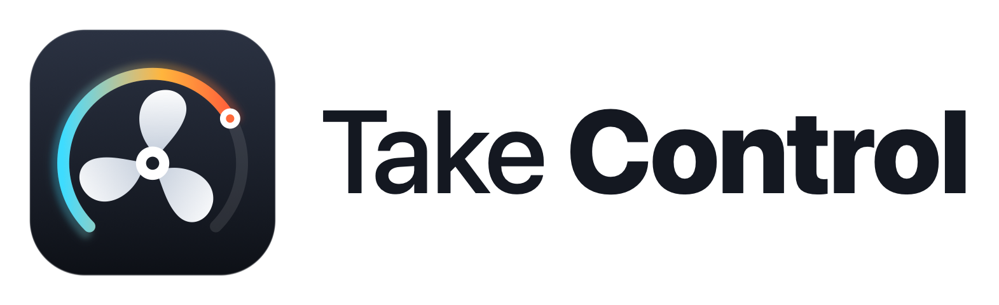
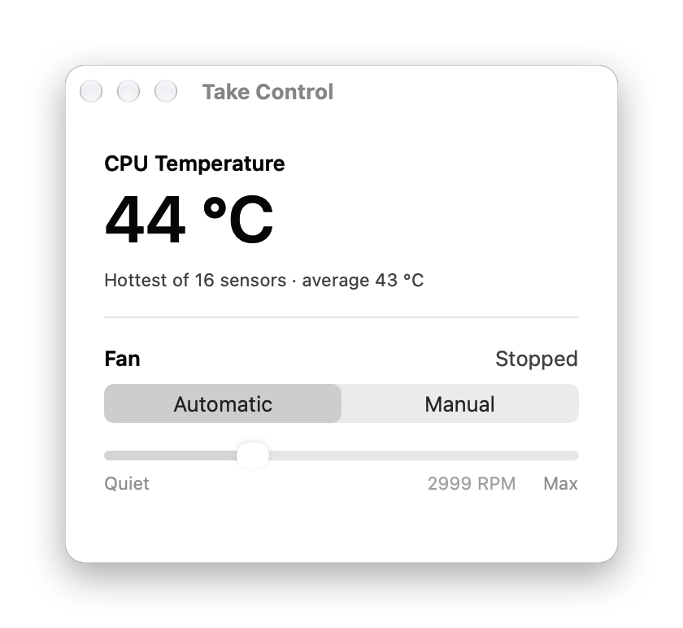
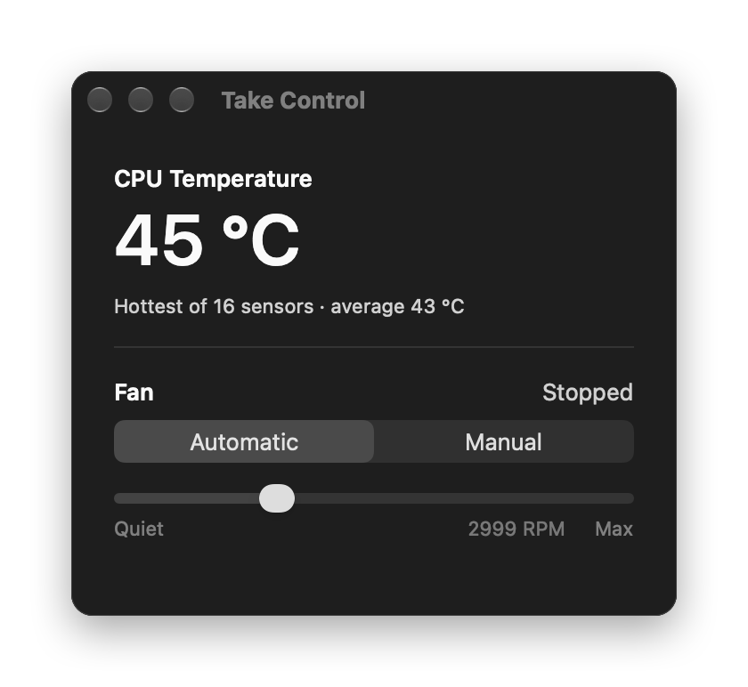
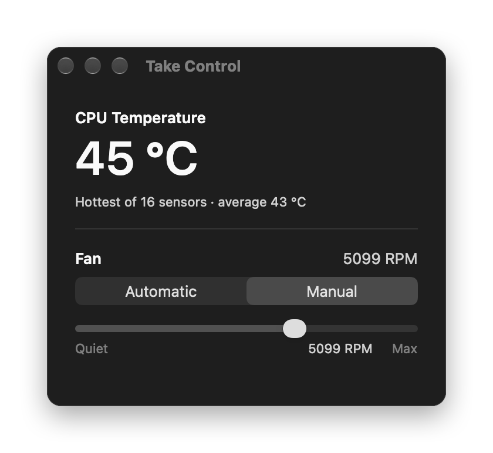
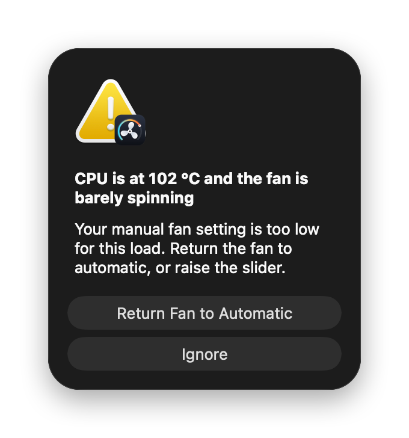

<p align="center">
  <picture>
    <source media="(prefers-color-scheme: dark)" srcset="Branding/png/logo-dark.png">
    
  </picture>
</p>

<p align="center">
  An extremely lightweight fan control app for Apple Silicon Macs.<br>
  CPU temperature and one fan slider. Nothing else.
</p>

<p align="center">
  <a href="https://github.com/eptkod/take-control/releases/latest"><b>Download the DMG</b></a>
</p>

<p align="center">
  
  
</p>

## Features

### Live CPU temperature
The window shows the hottest CPU sensor in large type, with the sensor count and the average underneath. Readings come straight from the chip's `PMU tdie` sensors and refresh every 2 seconds, but only while the window is on screen.

### One slider for the fan
Switch from **Automatic** to **Manual** and drag the slider from Quiet to Max. The target is mapped onto your fan's own minimum and maximum RPM, so it can never be set outside the range the hardware reports. The current fan speed is shown next to the "Fan" label.

<p align="center">
  
</p>

### Overheat warning
A cheap check runs every 10 seconds, even with the window closed. If the CPU reaches 100 °C while a fan is stopped or in the bottom quarter of its range, the menu bar icon turns into a red warning triangle and an alert pops up. In manual mode it offers to hand the fan straight back to macOS. The warning clears once the CPU drops below 90 °C.

<p align="center">
  
</p>

### Lives in the menu bar
There is no Dock icon. Click the menu bar icon to see the CPU temperature and each fan's RPM and mode (Auto or Manual), open the window, or quit. Closing the window keeps the app running and keeps holding your fan setting.

### Fails safe
The fan always goes back to automatic control when you pick Automatic, quit the app, or the app crashes or is killed. If the fans are found in manual mode at the next launch, they are handed back to macOS then too.

### Tiny
About 160 KB of native code (Swift, AppKit and C), arm64 only, no dependencies. Around 14 MB of memory and 0% CPU when idle.

## Requirements
- A Mac with Apple Silicon (M1, M2, M3 or M4)
- macOS 13 Ventura or later
- An administrator password, once, the first time you switch to Manual

Fanless Macs (such as the MacBook Air) can still use Take Control to read the CPU temperature.

## Install
1. Download `TakeControl-1.0.dmg` from the [latest release](https://github.com/eptkod/take-control/releases/latest).
2. Open it and drag **Take Control** into **Applications**.
3. The app is not notarized, so the first time you open it, right-click it in Applications and choose **Open**, then **Open** again. You can also run:
   ```sh
   xattr -dr com.apple.quarantine "/Applications/Take Control.app"
   ```

The first time you move the fan off Automatic, macOS asks for your administrator password. Take Control uses it once to install a small helper at `/Library/PrivilegedHelperTools/com.takecontrol.helper`, which is the only part that writes to the fan controller.

## Uninstall
Quit Take Control from its menu bar icon, then:
```sh
rm -rf "/Applications/Take Control.app"
sudo rm /Library/PrivilegedHelperTools/com.takecontrol.helper
```

## Build from source
You need the Xcode command line tools (`xcode-select --install`). No Xcode project is required.

```sh
./build.sh   # builds build/Take Control.app
./dmg.sh     # builds the app, then build/TakeControl-<version>.dmg
```

## How it works
| File | What it does |
|---|---|
| `Sources/main.swift` | The window, the menu bar item and the overheat watchdog |
| `Sources/temps.c` | Reads CPU temperatures through the IOKit HID event system |
| `Sources/smc.c` | Reads and writes AppleSMC keys (`F<n>Ac`, `F<n>Mn`, `F<n>Mx`, `F<n>Md`, `F<n>Tg`) |
| `Sources/helper.c` | The privileged helper. It takes fan levels on stdin and restores automatic control when stdin closes or it receives a signal |
| `Branding/` | Icon and logo sources. See [Branding/README.md](Branding/README.md) |

## Disclaimer
Running your fans slower than macOS would choose can let your Mac run hotter. Take Control clamps every setting to the fan's reported limits and warns you when the CPU overheats, but you use it at your own risk.
